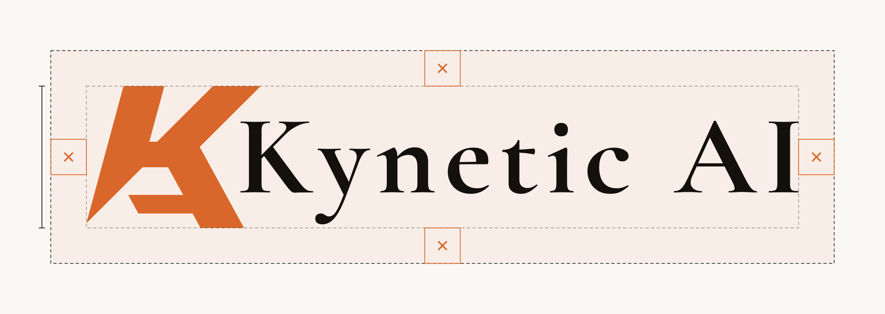

# Clear space and minimum sizes

## X

**X = 25% of the height of the K mark** (the mark is 4X tall). Keep at least X of empty space on all four sides of any lockup: no text, edges, images or other logos inside it.

Every lockup SVG in this folder already has X baked into its `viewBox` as padding, so placing the file edge-to-edge against other content keeps the rule. If you crop a lockup to its artwork, add X back.

## Files

| File | Notes |
|---|---|
| `lockup-b-horizontal-light.svg` / `-dark.svg` | Option B serif, mark left of name. Light = ink text, dark = off-white text |
| `lockup-b-stacked-light.svg` / `-dark.svg` | Option B serif, mark centered above name |
| `lockup-a-horizontal-light.svg` / `-espresso.svg` | Option A squared wordmark |
| `clearspace-diagram.svg` | The figure above (the only file here with guides) |

All files are transparent. Use `-light` on `#faf8f5` or white, `-dark` / `-espresso` on `#281F1C`.

## Option A has no stacked lockup

In option A the K mark is also the K of "Kynetic AI", so the wordmark can't be split into a mark and a name. Stacking the mark over "ynetic AI" reads wrong, and stacking it over a full name would repeat the K. Use `mark.svg` on its own where a compact square form is needed.

## Minimum sizes

| Asset | Digital | Print |
|---|---|---|
| K mark alone | 16 px wide | 8 mm wide |
| Wordmarks and lockups (width) | 120 px | 30 mm |

Below these sizes use the mark alone (or `favicon.ico` for 16 px tabs).
